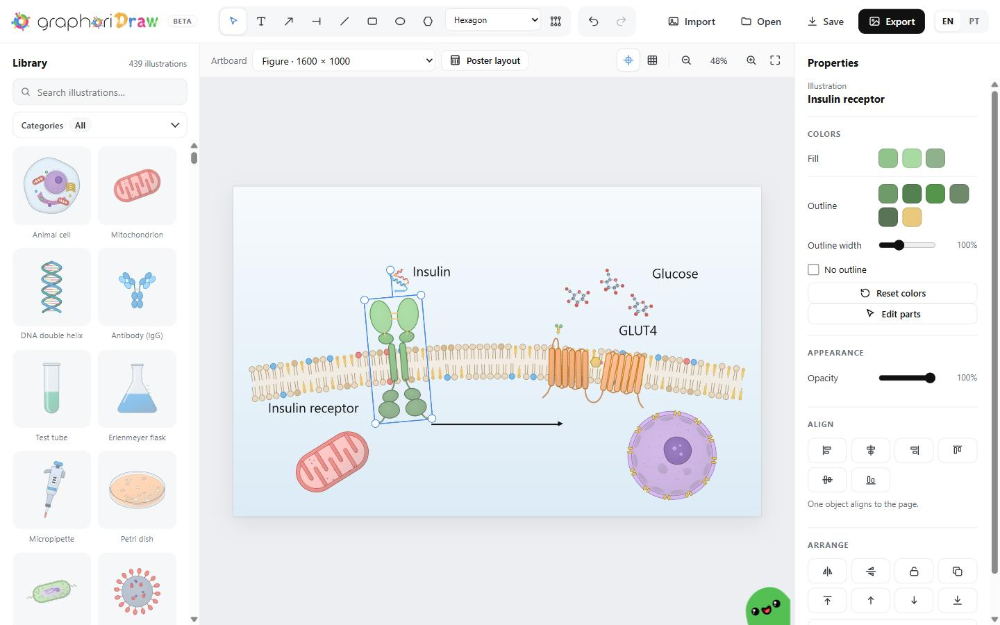
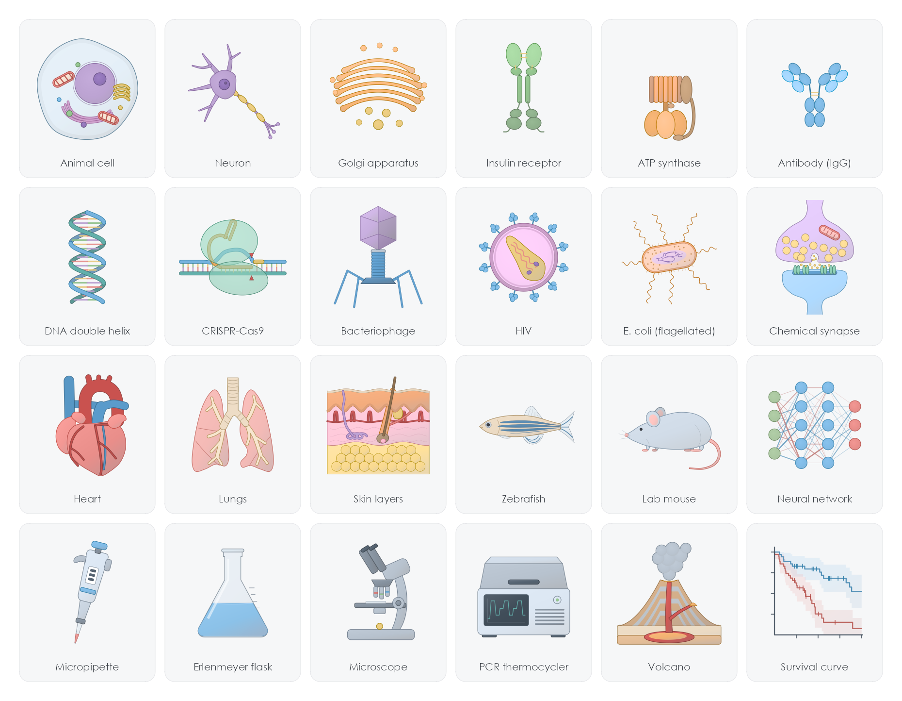

  <a href="https://graphori.org/draw/">
    <picture>
      <source media="(prefers-color-scheme: dark)" srcset="https://graphori.org/draw/assets/graphoridraw_logo_dark.svg">
      
    </picture>
  </a>

  <b>A free figure editor for science that runs in your browser.</b> 
  Build publication-ready schematics from more than 400 original illustrations, membranes you draw yourself, arrows and text. 
  No account, no installation, no paid plan.

  <a href="https://graphori.org/draw/"><b>Open the editor</b></a>
  &nbsp;·&nbsp;
  <a href="https://graphori.org/graphoridraw">See how it works</a>
  &nbsp;·&nbsp;
  <a href="#em-português">Em português</a>

  
  
  
  

  

This repository holds GraphoriDraw's documentation and license. The editor itself runs at **[graphori.org/draw](https://graphori.org/draw/)**: there is nothing to download or install.

## Quick start

1. Open <https://graphori.org/draw/>.
2. Search the library and click or drag illustrations onto the page. Add arrows, text and membranes with the tools at the top.
3. Click **Export**, choose PNG 4× or PDF, and credit the illustrations in your legend (see [below](#using-the-illustrations-in-your-work)).

Use it on a computer with a mouse, in an up-to-date browser such as Chrome, Edge or Firefox. It is not made for phones or tablets.

## What you can do

- **Pick from the library.** More than 400 illustrations in 23 categories, from cells, proteins and organs to lab glassware, geology and the social sciences. Search in English or Portuguese, then click an illustration or drag it onto the page.
- **Draw membranes.** The membrane tool draws a lipid bilayer or monolayer along your mouse: straight, any shape, or closed into a vesicle or a cell. Turn the outline into a mitochondrion with automatic cristae, mix 18 lipid classes (cholesterol, sphingomyelin, PE, cardiolipin and more) and add a legend.
- **Make it yours.** Recolor every fill and outline, or double-click an illustration to move, resize and recolor its parts. That changes only your copy, never the library.
- **Draw pathways.** Activation, inhibition (bar) and binding (dot) arrows, lines, and shapes for networks, with text inside them.
- **Lay it out.** Smart guides that snap to the page and to other objects, an optional grid, align and distribute, grouping, layer order (bring to front or send to back) and lock. Hold Shift to rotate in 15° steps.
- **Make posters.** Presets for A0, A1, 90 × 120 cm and 36 × 48 in, plus a ready-made poster layout with title band, sections and footer.
- **Bring your own.** Import SVG, PNG, JPEG, WebP or GIF files with the Import button, by dragging them onto the page, or by pasting.
- **Export.** PNG (1×, 2× or 4×, optionally transparent), JPEG, SVG (vector) and PDF (a high-resolution image on a page of the right size). Poster PDFs and SVGs keep their real size in millimeters.
- **Keep your figures on your computer.** Nothing you draw is uploaded. The page only downloads its drawing libraries from cdnjs, and the suggestions ghost sends your message (and your e-mail, if you give one) to us through Web3Forms. Your work is autosaved in this browser only, so save a project file (`Ctrl+S`) for anything important.
- **Use it in English or Portuguese.**

## The library

  

Every illustration is original, drawn by the Graphori team in one style: realistic structure, flat colors with a hint of volume, and a thin outline in a deeper tone of the same color, so they sit well together in a review-style figure.

- **Life sciences:** cells, organelles, membranes, proteins, tissues, organs, cancer, molecules, cell signaling, viruses, bacteria, protists and fungi, organisms.
- **Lab and medicine:** samples, lab glassware, equipment, medicine.
- **Other fields:** chemistry, geology, ecology and environment, social sciences, data and computing, plots.

## Using the illustrations in your work

You can use GraphoriDraw figures in papers, theses, posters, slides and teaching material, including commercial work. The illustrations are under [CC BY 4.0](https://creativecommons.org/licenses/by/4.0/), so please credit them in the figure legend or the acknowledgments:

> Illustrations: GraphoriDraw (graphori.org/draw), CC BY 4.0.

If you changed an illustration (its colors or parts), say so:

> Illustrations adapted from GraphoriDraw (graphori.org/draw), CC BY 4.0.

Shapes, text, arrows and membranes that you draw yourself with the editor's tools are yours and need no credit.

## Keyboard shortcuts

| Action | Keys |
|---|---|
| Tools: select, text, arrow, inhibition arrow, line, rectangle, ellipse, shapes, membrane | `V` `T` `A` `I` `L` `R` `E` `S` `M` |
| Undo / redo | `Ctrl+Z` / `Ctrl+Y` |
| Copy / cut / paste, duplicate | `Ctrl+C` / `Ctrl+X` / `Ctrl+V`, `Ctrl+D` |
| Group / ungroup | `Ctrl+G` / `Ctrl+Shift+G` |
| Select all, delete | `Ctrl+A`, `Delete` or `Backspace` |
| Cancel drawing, deselect | `Esc` |
| Nudge (10 px with Shift) | Arrow keys |
| Add to the selection | `Shift`+click |
| Resize freely, rotate in 15° steps | `Shift` while dragging a corner or the rotation handle |
| Move without snapping to guides | `Alt` while dragging |
| Zoom in / out, fit the page | `Ctrl+=` / `Ctrl+-`, `Ctrl+0`, or `Ctrl`+wheel |
| Move the view | `Space`+drag or the middle mouse button |
| Save the project | `Ctrl+S` |

On a Mac, use `Cmd` instead of `Ctrl`.

## Suggestions and bugs

- **Missing an illustration or have an idea?** Click the ghost in the bottom-right corner of the editor and tell us. The illustrations are drawn by the Graphori team, so we do not take drawings or files from others; describe what you need and we will draw it.
- **Found a bug?** [Open an issue](https://github.com/Graphori/graphoridraw/issues) and tell us what happened and in which browser.

## License

- **Illustrations:** [CC BY 4.0](LICENSE).
- **The editor's code** (the page at graphori.org/draw): [MIT](LICENSE).
- The Graphori, GraphoriStat and GraphoriDraw names and logos and the four ghost mascots are not covered by these licenses. See [LICENSE](LICENSE) for the full text.

## Part of Graphori

GraphoriDraw is made by [Graphori](https://graphori.org), an independent, non-profit, open data-science initiative for research. Its sibling project is [GraphoriStat](https://github.com/Graphori/graphoristat), a free statistics app written in R. Follow us on Instagram at [@graphori_org](https://www.instagram.com/graphori_org/).

---

## Em português

O **GraphoriDraw** é um editor gratuito de figuras científicas que roda no navegador, sem conta e sem instalação. Você monta esquemas com mais de 400 ilustrações originais em 23 categorias, desenha membranas lipídicas (e até mitocôndrias com cristas), acrescenta setas de ativação e inibição, textos e formas, e exporta em PNG, JPEG, SVG ou PDF, inclusive pôsteres em tamanho real (PDF e SVG). A interface está em inglês e português.

- **Abrir o editor:** <https://graphori.org/draw/> (não precisa baixar nada).
- **Sugestões e ilustrações que faltam:** clique no fantasminha no canto inferior direito do editor. As ilustrações são desenhadas pela equipe da Graphori; não recebemos desenhos de terceiros, mas desenhamos o que você pedir.
- **Erros:** [abra uma issue](https://github.com/Graphori/graphoridraw/issues).

As ilustrações estão sob a licença [CC BY 4.0](https://creativecommons.org/licenses/by/4.0/deed.pt-br): você pode usá-las em artigos, teses, pôsteres e aulas, inclusive comercialmente, desde que dê o crédito na legenda ou nos agradecimentos:

> Ilustrações: GraphoriDraw (graphori.org/draw), CC BY 4.0.

Se você alterou alguma ilustração, escreva "Ilustrações adaptadas de GraphoriDraw (graphori.org/draw), CC BY 4.0". O que você desenha com as ferramentas do editor não precisa de crédito. O GraphoriDraw faz parte da [Graphori](https://graphori.org), uma iniciativa independente e sem fins lucrativos de ciência de dados aberta.
